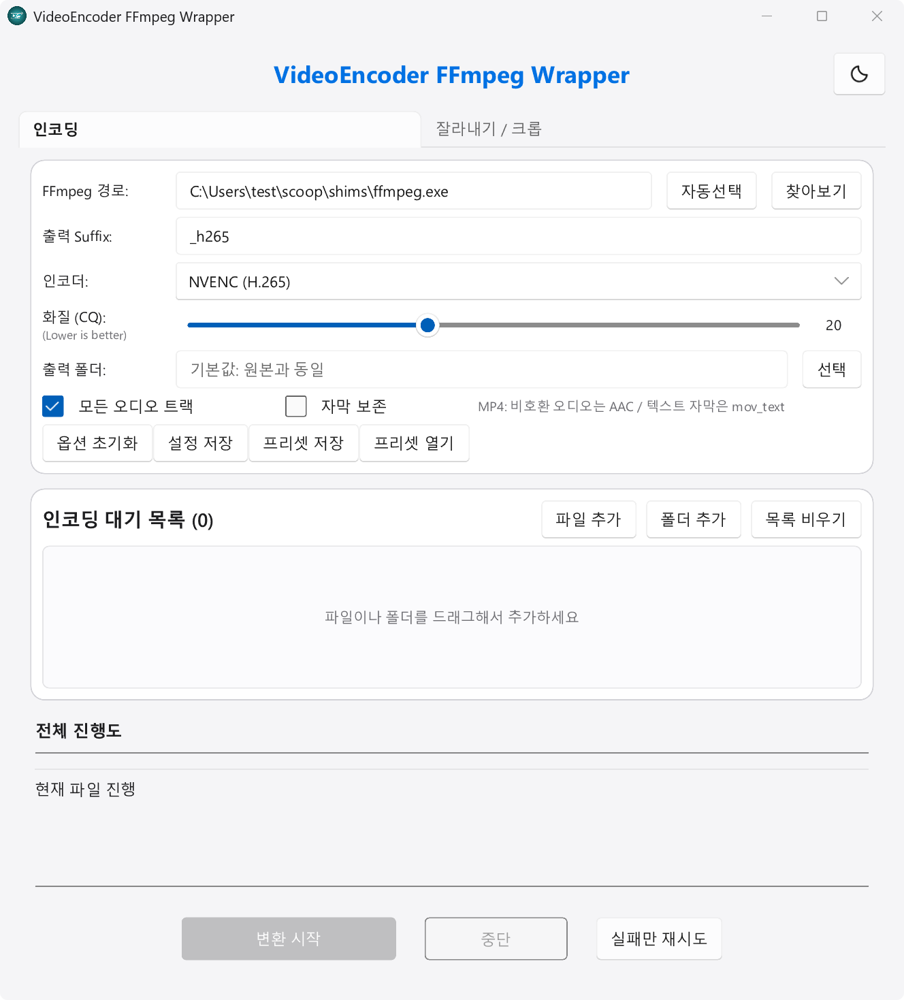

# VideoEncoder FFmpeg Wrapper

[](https://slint.dev)

A lightweight, high-performance video encoding GUI built with **Rust** and **Slint**. It batches video conversion through **FFmpeg**, optimized for HEVC (H.265).

 

## Key Features

-   **Light / Dark Theme**: Toggle at the right of the title; the native title bar follows the theme.
-   **Native Windows Drag & Drop**: Drop files and folders anywhere on the window.
-   **Selectable Encoder**: NVIDIA NVENC (H.265, default) or x265 (CPU). The quality slider switches between CQ and CRF automatically, and each encoder keeps its own value.
-   **Batch Queue**: Add files or folders, reorder with ↑/↓, remove single items, clear the list, and retry only the failed jobs.
-   **Detailed Progress**: Per-file and overall percentage, encoding speed (x), live bitrate, and Windows taskbar progress.
-   **Audio / Subtitle Tracks**: Keep all audio tracks or only the first, and optionally preserve subtitles.
-   **Persistent Settings & Presets**: Options are restored at launch and saved on exit; presets can be exported and imported as JSON.
-   **Video Editor (Trim / Cut / Crop)**: Built-in preview player with frame scrubbing, fast or exact cutting, and an interactive crop overlay with HEVC re-encoding.

## Prerequisite

-   **[FFmpeg](https://ffmpeg.org/)** (`ffmpeg`, `ffprobe`, `ffplay`): All three binaries are required.
    -   `ffmpeg` encodes; `ffprobe` analyzes streams (duration, resolution, frame rate, codec types) and drives the progress percentage; `ffplay` provides sound in the editor preview (the preview still works silently without it).
    -   Lookup order: the app's own folder (next to the configured `ffmpeg.exe`), then your system `PATH`. You can also set the path manually or with **Auto-detect**.
-   **[NVIDIA GPU](https://www.nvidia.com/) (optional)**: Required only for **NVENC (H.265)**. Use **x265 (CPU)** on systems without a supported NVIDIA GPU.

## Getting Started

### 📥 Download

Download the latest build from the [Releases Page](https://github.com/kirinonakar/VideoEncoder/releases).

### Manual build

1.  Clone the repository:
    ```bash
    git clone https://github.com/kirinonakar/VideoEncoder.git
    cd VideoEncoder
    ```
2.  Install [Rust](https://www.rust-lang.org/tools/install).
3.  Build and run:
    ```bash
    cargo run --release
    ```

## Encoder Options

-   **NVENC (H.265)** (default): `-c:v hevc_nvenc -preset p7 -rc vbr -cq <quality> -b:v 0` (constant-quality VBR). Default: **CQ 20**.
-   **x265 (CPU)**: `-c:v libx265 -crf <quality> -preset medium`. Default: **CRF 19**.
-   The selected encoder and quality are used for batch conversion and for crop / exact-cut re-encoding in the editor.
-   **Reset Options** restores the defaults: NVENC, CQ 20, CRF 19, suffix `_h265`, output folder = source folder, all audio tracks on, subtitles off, fast cut mode.

## Output & Track Handling

-   **Output Suffix**: Appended to the source file name. Path separators (`/`, `\`, `:`) are rejected.
-   **Output Folder**: Empty means the source folder.
-   **All Audio Tracks**: On keeps every audio stream; off keeps only the first.
-   **Preserve Subtitles**: Copies text subtitles (`mov_text` for MP4); incompatible subtitle codecs in MP4 are reported as an error instead of being silently dropped.
-   **MP4 Compatibility**: Audio codecs that MP4 players commonly reject (DTS, FLAC, Opus, Vorbis, …) are re-encoded to AAC; AAC, MP3, AC-3, E-AC-3 and ALAC are copied.
-   **Incomplete Outputs**: Files are written under a temporary name and renamed on success, so failed jobs never leave a usable-looking result.

## Settings & Presets

-   Settings are loaded at startup and saved automatically on exit to `%APPDATA%\VideoEncoder\settings.json` (`~/.config/VideoEncoder/settings.json` on other platforms).
-   **Save Settings** writes the current state immediately.
-   **Export / Import Preset** stores every option (FFmpeg path, encoder, quality, suffix, output folder, track options, cut mode, theme) in a JSON file.
-   Older or partial JSON presets remain readable; missing values fall back to defaults.

## Video Editor (Trim / Cut / Crop)

-   **Preview Player**: Click or drag the upper timeline to seek by frame (extracted via FFmpeg) and preview the crop area live.
-   **Edit**: One button applies the crop region, the selected time range, or both. With neither set, the app asks you to define one first.
-   **Trim / Cut**: Set the range with the two-handle slider aligned to the playback timeline or with **Set Start / Set End** (minimum 0.05 s). Each handle supports arrow keys and Home/End. **Fast cut** copies streams (`-c copy`, possible keyframe offset); **exact cut** frame-aligns the start and re-encodes HEVC plus AAC to MP4.
    -   Output: `{name}_cut.{ext}` (fast) or `{name}_cut_exact.mp4` (exact).
-   **Crop**: Drag or resize the overlay on the preview. The region is applied with the FFmpeg `crop` filter and re-encoded to HEVC using the configured encoder and quality. Without a time range the whole video is cropped; with a range an exact cut is applied too and audio is re-encoded to AAC.
    -   Output: `{name}_crop.mp4`.
-   **Playback Limit / Rewind**: **Limit playback** constrains seeking and playback to the selected range. Rewind jumps to the video start, or to the range start while limited, preserving play/pause state.
-   **Live Feedback**: Crop coordinates, output resolution, progress bar and status messages are updated in real time, and running jobs can be cancelled.

## License

This project is licensed under the MIT License - see the [LICENSE](LICENSE) file for details.

## Third-Party Notices

-   **Slint** (GUI framework, v1.15) — Copyright © Slint GmbH. Slint is triple-licensed: [GPLv3](https://www.gnu.org/licenses/gpl-3.0.html), the [Slint Royalty-free Desktop and Web License](https://slint.dev/pricing), or a commercial license. This project's own code remains MIT; an open-source distribution can rely on the GPLv3 option (the combined binary is then covered by GPLv3), while a proprietary distribution needs the royalty-free license with Slint attribution or a commercial license.
-   **FFmpeg / ffprobe / ffplay** — Copyright © the FFmpeg developers. This app does not bundle or link FFmpeg; it runs the binaries you provide as separate processes. FFmpeg is licensed under the [LGPL v2.1 or later](https://www.ffmpeg.org/legal.html), but builds configured with `--enable-gpl` (required for `libx265`, used by the **x265 (CPU)** encoder) are licensed under the GPL v2 or later. If you redistribute FFmpeg binaries with this app, you are responsible for complying with the license of that build (source availability, license texts, and attribution).
